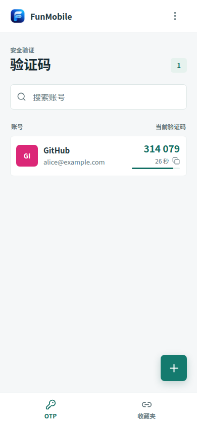
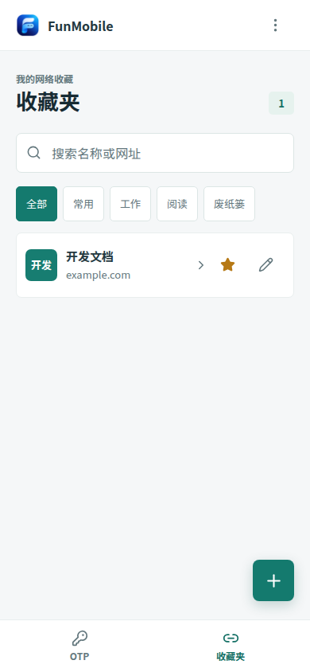
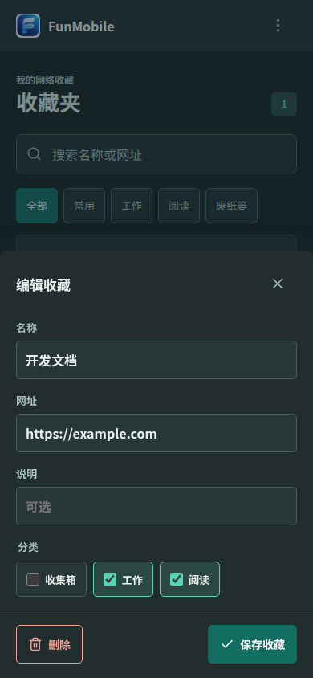

# FunMobile

Android application with built-in FunOTP and FunLink views. The app reuses their backup formats and pure business logic; it does not install or run `.upxs` packages.

## Screenshots

These previews use sample data and the UI bundled in the Android APK, rendered at a 390px mobile viewport.

  
  
  

## First version

- OTP: TOTP, HOTP and Steam codes, add or edit an account, scan an `otpauth://` QR code with the camera/file picker, import and export FunOTP JSON backups.
- Bookmarks: search, filter by category, choose among a bookmark's HTTP(S) URLs, edit all category assignments, favorites, trash and restore, import and export FunLink JSON backups.
- The interface follows the Android system light/dark setting. The Android back button closes a sheet before leaving the current view.
- Android data is stored with `@aparajita/capacitor-secure-storage` using AES-GCM, Android Keystore and SharedPreferences. Browser development mode uses `localStorage` and is not secure storage.

The Android app icon uses the shared farfarfun brand asset from `farfarfun/.github/brand`.

The phone app and desktop uTools plugins currently keep **separate local data**. Importing a backup replaces the phone's data for that module after confirmation. Exported backups are plaintext, especially OTP secrets. There is no automatic sync yet.

If stored data cannot be read, that module stops writes and cannot export an empty replacement backup. A valid backup can still be imported to recover it.

## Build

GitHub Actions runs tests, builds the web assets, syncs Capacitor and compiles a debug APK. Download the APK from the [v0.1.0 release](https://github.com/farfarfun-utools/utools-mobile/releases/tag/v0.1.0) or the `funmobile-debug-apk` artifact of a successful workflow run. The APK is signed with the Android debug key and is for testing, not store distribution.

For development in an environment that permits local builds, use `pnpm install --frozen-lockfile`, `pnpm test`, `pnpm build`, `pnpm android:sync`, then build the Android project with Gradle. This workspace runs builds and tests through GitHub Actions.

## Source

The desktop business modules are copied into `src/shared/` at the versions listed in [NOTICE.md](NOTICE.md). When either plugin changes its data format or OTP rules, update those modules and the compatibility test together.
